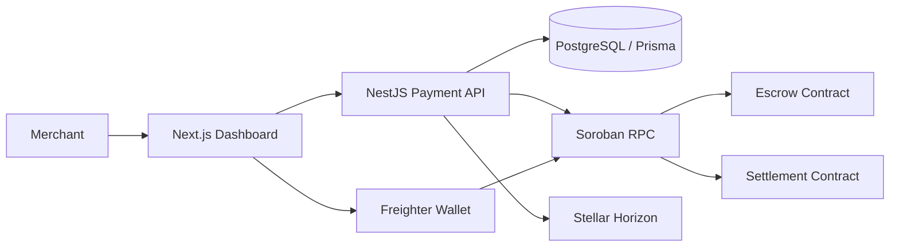
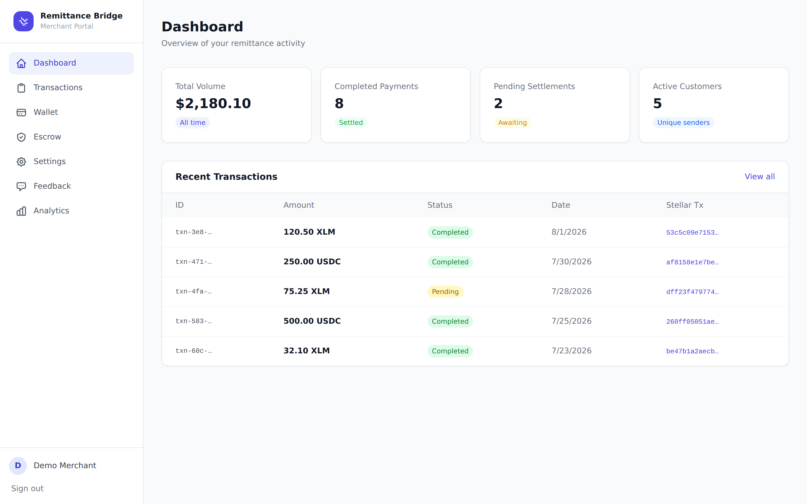
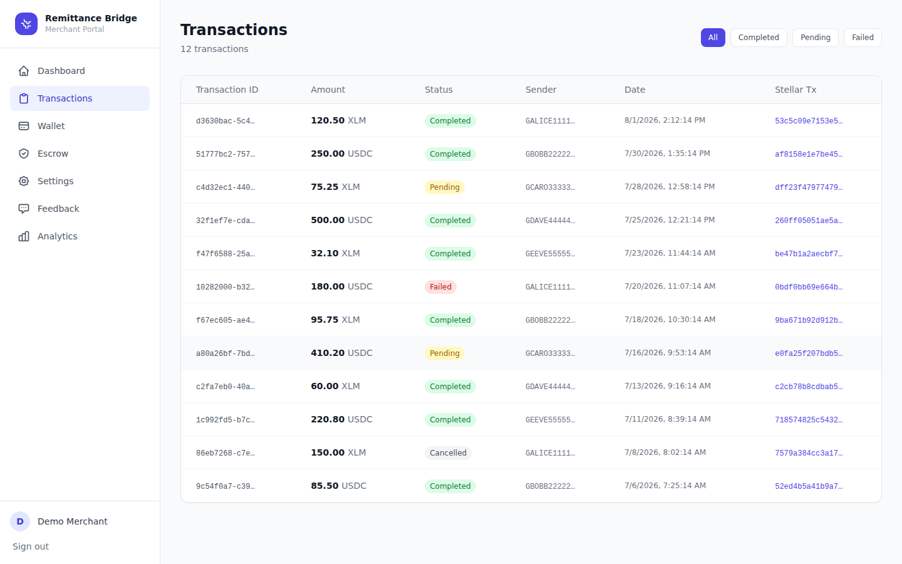
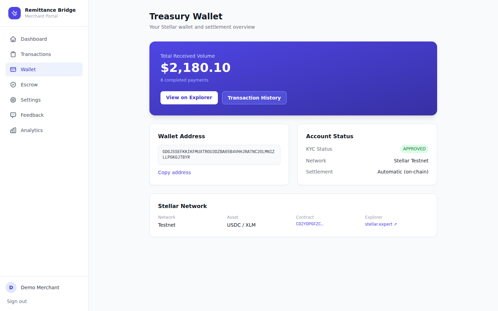
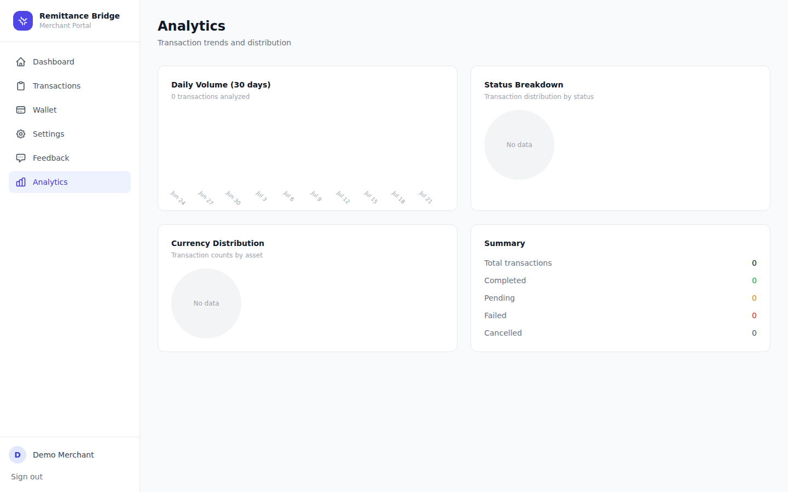
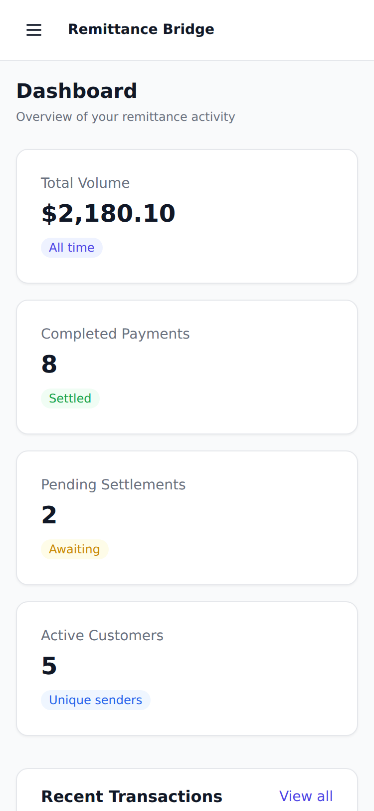
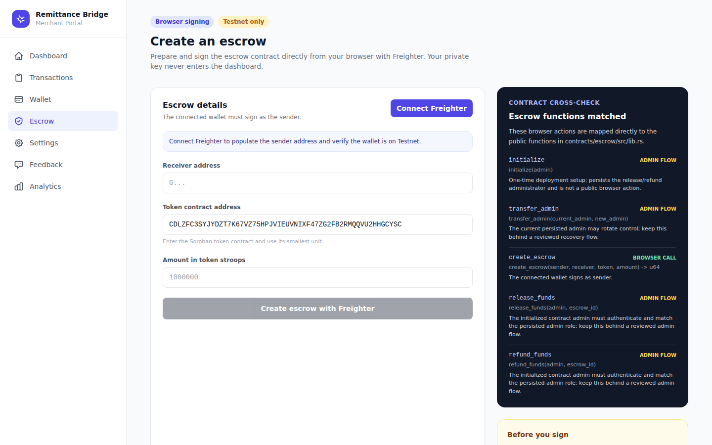

# Global Micro-Remittance Bridge

A testnet-focused cross-border payment prototype built with Stellar, Soroban smart contracts, a NestJS API, and a Next.js merchant dashboard.

> **Status: Testnet prototype.** This repository is for development, evaluation, and Stellar Testnet use only. It is not a licensed remittance service, has not completed an independent security audit, and must not be used to transfer real value. It does not provide production fiat on-ramps/off-ramps or a complete KYC/AML compliance programme.

## What the project does

The project explores how a merchant payment flow can be coordinated across an application backend and Stellar smart contracts. It includes:

- A Next.js merchant dashboard for viewing merchant and payment information and interacting with the Testnet escrow flow.
- A NestJS API with merchant authentication, payment endpoints, and Stellar/Soroban service integrations.
- Rust-based Soroban contracts for escrow state transitions and settlement fee distribution.
- PostgreSQL persistence through Prisma.
- Testnet transaction evidence and automated tests for key contract and application flows.

The current implementation is a technical prototype. References to anchors, notifications, compliance screening, fiat rails, or production settlement should be treated as future integration areas unless a specific implementation is present in the code.

## Architecture



**Main components**

| Component | Responsibility |
|---|---|
| `merchant-dashboard/` | Next.js interface, including the user-initiated Testnet escrow page |
| `payment-api/` | NestJS API, authentication, payment logic, and server-side Stellar/Soroban integration |
| `contracts/escrow/` | Soroban escrow creation, release/refund state, and administrator controls |
| `contracts/settlement/` | Settlement calculations and merchant/treasury fee distribution |
| PostgreSQL + Prisma | Application data persistence |
| Stellar Testnet | Blockchain environment used for development and verification |

The dashboard's browser escrow flow uses Freighter for wallet connection and transaction signing. It does not ask the browser user to provide a private key. Administrative release/refund operations are protected contract flows and are not exposed as unrestricted browser actions.

## Technology

- **Frontend:** Next.js 14, React, TypeScript, Tailwind CSS
- **Backend:** NestJS, TypeScript
- **Database:** PostgreSQL, Prisma
- **Blockchain:** Stellar, Soroban RPC, Stellar SDK
- **Smart contracts:** Rust, `soroban-sdk`
- **Wallet:** Freighter browser wallet integration
- **Testing and tooling:** Jest, Playwright, Cargo, GitHub Actions
- **Deployment tooling:** Vercel for the dashboard; backend deployment configuration is documented in the repository

## Repository layout

```text
global-remittance-bridge/
├── contracts/
│   ├── escrow/
│   └── settlement/
├── payment-api/
├── merchant-dashboard/
├── docs/
└── screenshots/
```

See [docs/ARCHITECTURE.md](docs/ARCHITECTURE.md), [docs/ARCHITECTURE_DIAGRAMS.md](docs/ARCHITECTURE_DIAGRAMS.md), and [docs/LIVE_TESTNET_VERIFICATION.md](docs/LIVE_TESTNET_VERIFICATION.md) for deeper implementation and verification notes.

## Run locally

### Prerequisites

- Node.js 18 or later
- npm
- Rust and the WebAssembly target required by Soroban
- Stellar CLI
- PostgreSQL
- A Stellar Testnet account and Freighter browser wallet for wallet-based testing

### 1. Clone the repository

```bash
git clone https://github.com/Timrossid/global-remittance-bridge.git
cd global-remittance-bridge
```

### 2. Configure and run the API

```bash
cd payment-api
cp .env.example .env
```

Set the required values in `.env`. In particular, configure the database URLs, a strong JWT secret, and the Stellar Testnet/Soroban settings described in `.env.example`. Keep secrets out of source control.

```bash
npm install
npx prisma migrate deploy
npm run start:dev
```

The API is configured to run locally at `http://localhost:3001`.

### 3. Configure and run the dashboard

In a second terminal:

```bash
cd merchant-dashboard
cp .env.example .env.local
```

Set `NEXT_PUBLIC_API_URL=http://localhost:3001` and the required Testnet contract, RPC, network, and token values in `.env.local`.

```bash
npm install
npm run dev
```

The dashboard is available at `http://localhost:3000`.

### 4. Build and deploy Soroban contracts to Testnet

Contract deployment requires a funded Stellar Testnet deployer account and the Stellar CLI. Follow the current, step-by-step instructions in the contract and deployment documentation before deploying. Do not use Mainnet credentials or real funds.

## Tests and validation

The repository includes:

- Soroban unit tests for escrow state transitions, authorization, initialization, and settlement calculations.
- Payment API Jest tests.
- Playwright dashboard tests, including CI-only mocked wallet and Soroban RPC flows.
- GitHub Actions workflows for contract checks, application builds, linting, and test execution.

The Playwright wallet/RPC tests use mocks. They do not prove a live wallet transaction. For the latest commands, known results, and live Testnet verification steps, see [docs/LIVE_TESTNET_VERIFICATION.md](docs/LIVE_TESTNET_VERIFICATION.md) and the workflow files.

## Screenshots

The repository includes dashboard and escrow screenshots:

| View | Screenshot |
|---|---|
| Merchant dashboard |  |
| Transactions |  |
| Treasury wallet |  |
| Analytics |  |
| Mobile layout |  |
| Escrow and Freighter flow |  |

These images illustrate the interface. Refer to the Testnet verification notes and transaction evidence for the scope of on-chain testing.

## Current status and limitations

Implemented in the repository:

- Merchant dashboard and NestJS payment API.
- Stellar SDK and Soroban RPC integration paths.
- Escrow contract with create, release, refund, and administrator functionality.
- Settlement contract with a 50 basis-point (0.5%) fee calculation/distribution path.
- Freighter-based, user-initiated Testnet escrow interaction.
- Automated contract, API, and dashboard tests.
- Testnet deployment and transaction verification documentation.

Not represented as production-ready:

- Fiat payment collection or payout rails.
- A complete KYC/AML or sanctions-screening service.
- Money-transmission licensing or jurisdictional approvals.
- Independent smart-contract or application security audit.
- Production Mainnet operations, custody, or real-value settlement.

For the exact state of deployed contract instances, initialization, and verification evidence, consult [docs/LIVE_TESTNET_VERIFICATION.md](docs/LIVE_TESTNET_VERIFICATION.md) and [screenshots/DEMO_SUBMISSION_NOTES.md](screenshots/DEMO_SUBMISSION_NOTES.md). Deployment addresses and statuses can change as Testnet contracts are redeployed.

## Contributing

Issues and pull requests are welcome. Please:

1. Describe the problem and the intended change.
2. Keep changes scoped and include tests where appropriate.
3. Never commit credentials, wallet secrets, or environment files.
4. Clearly distinguish mocked tests from live Testnet evidence.

For security-sensitive findings, avoid publishing exploitable details in a public issue.

## License

See the repository's [LICENSE](LICENSE) file for the applicable license.
